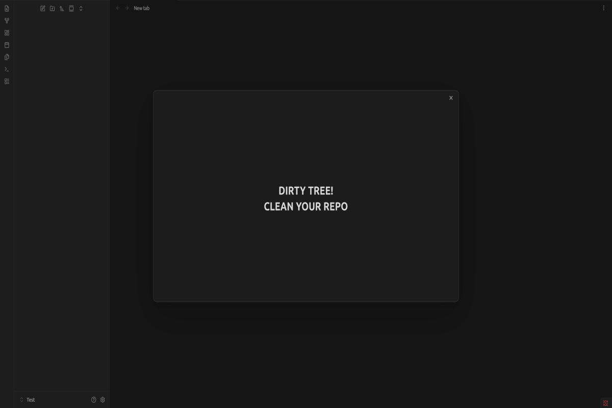

# Dirty Tree Warning

A large, hard-to-miss warning when you quit Obsidian with uncommitted Git changes in your vault.

## What it does

If your vault is a Git repository, this plugin checks the Git working tree when you close Obsidian.

- **Uncommitted changes:** a large message appears, reading **DIRTY TREE! CLEAN YOUR REPO**. Obsidian then finishes closing on its own a few seconds later.
- **Clean working tree, or a vault that isn't in a Git repository:** Obsidian closes normally. Nothing is shown.

The warning follows your active Obsidian theme.

**It doesn't stop Obsidian from closing.** It's a reminder, not a lock. If you see it, open the vault in a terminal and commit (or otherwise clean up) your changes.

## Commands

Open the command palette (Ctrl+P / Cmd+P) and search for **Dirty Tree Warning**:

| Command | What it does |
|---|---|
| **Preview warning** | Shows the warning without closing Obsidian, so you can see how it looks. Press Esc to dismiss it. |
| **Check working tree now** | Shows a short notice saying whether the working tree is clean or has uncommitted changes. |

No hotkeys are set. You can assign your own in Settings → Hotkeys.

## Requirements

- Obsidian on desktop (Windows, macOS or Linux). Mobile isn't supported.
- Git installed and available as `git` on your system path.
- A vault that is inside a Git repository.

Files ignored by your `.gitignore` don't count as changes. If you don't want Obsidian's own settings folder to trigger the warning, add `.obsidian/` to your `.gitignore`.

## Disclosures

- **Runs a local program:** the plugin runs the `git` executable (`git status --porcelain`) in your vault folder when you close Obsidian, and when you use **Check working tree now**.
- **Reads files outside the vault:** Git may read repository data (the `.git` folder) that lives outside the vault, for example when the vault is a subfolder of a larger repository.
- **No network access:** nothing is sent anywhere. The plugin makes no network requests.
- **Changes nothing:** the plugin never commits, stages or modifies files.
- **Desktop only.**

## Installation

In Obsidian: **Settings → Community plugins → Browse**, search for **Dirty Tree Warning**, then select **Install** and **Enable**.

## Support and maintenance

This plugin is provided **as is**. It works for its author, and it's shared in the hope that it's useful to others.

- **No support is offered,** and there's no way to contact the author about it.
- **No updates or fixes are planned.**
- **Issues and contributions aren't accepted.**

If it doesn't work for you, or you'd like it to behave differently, you're welcome to modify it under the terms of the license below.

## License

Copyright (C) 2026 Top Tier Content

This program is free software: you can redistribute it and/or modify it under the terms of the **GNU General Public License as published by the Free Software Foundation, either version 3 of the License, or (at your option) any later version** (`GPL-3.0-or-later`). See [LICENSE](LICENSE).

If you distribute a modified version, keep the copyright notice above and credit **Top Tier Content** as the original author, as the license requires.

This program is distributed in the hope that it will be useful, but **WITHOUT ANY WARRANTY**; without even the implied warranty of MERCHANTABILITY or FITNESS FOR A PARTICULAR PURPOSE.
